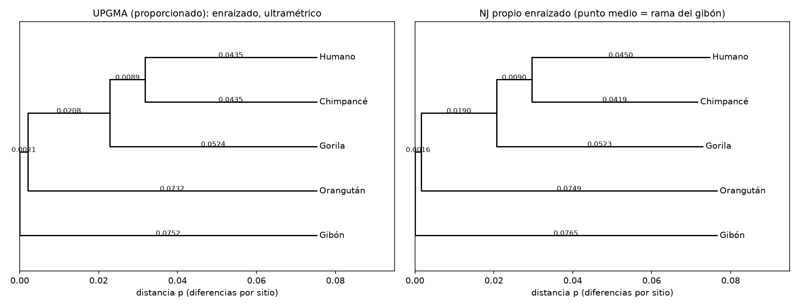

# Práctica A · Reconstrucción filogenética (COX1 de cinco primates)

**Autores:** Daniel Perdomo Medina y Aimar Alejandro Santana

Revisión del código proporcionado (distancias p + UPGMA), **implementación propia de Neighbor-Joining**
y comparación de ambos métodos. Asignatura de Bioinformática, Bloque II.

📄 Informe: [`informe/informe.pdf`](informe/informe.pdf)

## Estructura y autoría

| Ruta | Autoría | Contenido |
|---|---|---|
| `proporcionado/procesar_datos.py` | Proporcionado | GenBank → COX1 validado → alineamiento → distancias p → UPGMA |
| `proporcionado/generar_animacion.py` | Proporcionado | GIF de la construcción UPGMA y figura del árbol |
| `proporcionado/genbank/` | Proporcionado | 5 registros GenBank (NC_012920.1, NC_001643.1, NC_001645.1, NC_001646.1, NC_002082.1) |
| `proporcionado/*.csv, *.fasta, *.nwk, *.json, imagenes/` | Generado por el código proporcionado | Resultados intermedios (`distancias.csv` es la entrada de NJ) |
| **`nj.py`** | **Propio** | Lectura/validación de la matriz y algoritmo Neighbor-Joining, traza de iteraciones, Newick y figura |
| **`arboles.py`** | **Propio** | Biparticiones, distancia de Robinson-Foulds, distancias patrísticas, enraizado por punto medio, UPGMA como función |
| **`comparar.py`** | **Propio** | NJ propio vs Biopython; UPGMA vs NJ; ejemplo sintético sin reloj molecular |
| **`tests/test_nj.py`** | **Propio** | 22 pruebas (ejemplo de clase, árbol aditivo, validación, Biopython) |
| `resultados/` | Generado por el código propio | `arbol-nj.nwk`, `iteraciones-nj.{csv,json}`, `traza-nj.txt`, `arbol-nj.png`, `comparacion.md`, `upgma-vs-nj.png` |
| `informe/informe.pdf` | Propio | Informe de la práctica (compilado con LaTeX) |

`nj.py` **no** usa ninguna función de biblioteca que implemente Neighbor-Joining. `Bio.Phylo.TreeConstruction`
solo se usa en `comparar.py` y en los tests como implementación de referencia.

## Bibliotecas

- **Biopython**: `SeqIO`, `Align.PairwiseAligner`, `Seq` (código proporcionado); `Phylo` para leer, enraizar y dibujar árboles;
  `Phylo.TreeConstruction` solo como referencia.
- **NumPy**: operaciones con matrices ($r$, $Q$, actualización de $D$).
- **Matplotlib** y **Pillow**: figuras y animación.
- Biblioteca estándar: `csv`, `json`, `argparse`, `unittest`.

## Cómo ejecutarlo

Requiere Python ≥ 3.9.

```bash
git clone https://github.com/bioinformatica-ulpgc/de-las-secuencias-del-ADN--rbol-filogen-teico.git
cd de-las-secuencias-del-ADN--rbol-filogen-teico
python3 -m venv .venv && source .venv/bin/activate      # Windows: .venv\Scripts\activate
pip install -r requirements.txt

bash ejecutar_todo.sh            # todo de golpe, o paso a paso:

python proporcionado/procesar_datos.py     # distancias.csv, arbol-upgma.nwk, resultados.json...
python proporcionado/generar_animacion.py  # imagenes/construccion-upgma.gif
python nj.py                               # NJ propio: imprime la traza y escribe resultados/
python -m unittest -v                      # 22 pruebas
python comparar.py                         # resultados/comparacion.md y upgma-vs-nj.png
```

`nj.py` acepta otra matriz con el mismo formato: `python nj.py --entrada mi_matriz.csv --salida otra_carpeta/`.

## Neighbor-Joining (notación de la asignatura)

Mientras queden $n>3$ nodos:

- $r(i)=\sum_k d(i,k)$, $\quad Q(i,j)=(n-2)\,d(i,j)-r(i)-r(j)$ → se une el par con $Q$ mínimo (empates por orden alfabético)
- $L(i,U)=\dfrac{d(i,j)}{2}+\dfrac{r(i)-r(j)}{2(n-2)}$, $\quad L(j,U)=d(i,j)-L(i,U)$
- $d(U,k)=\dfrac{d(i,k)+d(j,k)-d(i,j)}{2}$

Unión final de $a,b,c$: $L(a)=\dfrac{d(a,b)+d(a,c)-d(b,c)}{2}$, y de forma análoga para $b$ y $c$.

## Resultados principales

| | Newick |
|---|---|
| UPGMA (proporcionado) | `((((Homo_sapiens:0.04345,Pan_troglodytes:0.04345):0.00892,Gorilla_gorilla:0.05237):0.02081,Pongo_pygmaeus:0.07317):0.00205,Hylobates_lar:0.07523);` |
| NJ (propio) | `(Homo_sapiens:0.04499,Pan_troglodytes:0.04191,(Gorilla_gorilla:0.05229,(Hylobates_lar:0.07815,Pongo_pygmaeus:0.07490):0.01905):0.00900);` |

- NJ propio = NJ de Biopython: Robinson-Foulds 0 y diferencia máxima de longitud de rama de 4·10⁻¹⁰.
- UPGMA y NJ dan la misma topología no enraizada (RF = 0). Si el árbol NJ se enraíza con el gibón, los clados son los mismos: ((((H,C),G),O),Gibón).
- UPGMA da un árbol ultramétrico. En NJ las profundidades de las hojas varían un ~7 %, lo que indica una ligera heterogeneidad de tasas.


