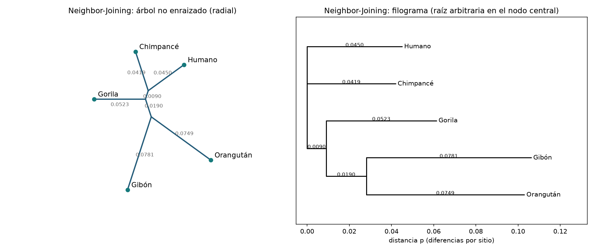
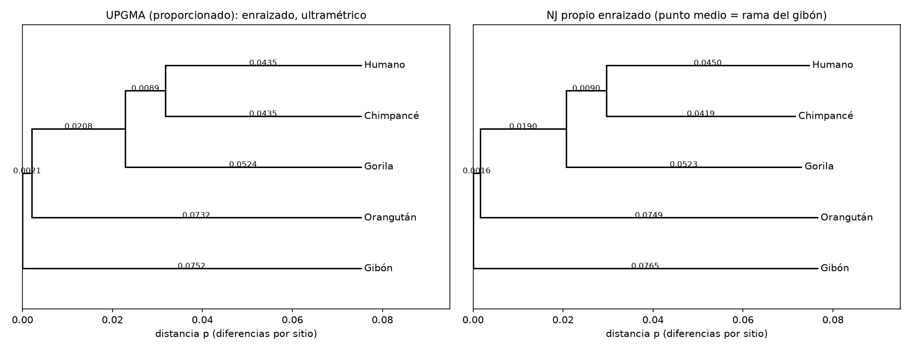

**Repositorio:** <https://github.com/bioinformatica-ulpgc/de-las-secuencias-del-ADN--rbol-filogen-teico>

# 1. Objetivo y organización del trabajo

Partimos de las secuencias del gen mitocondrial COX1 de cinco primates (humano, chimpancé, gorila, orangután y gibón) y de los dos scripts facilitados, que calculan una matriz de distancias p y construyen un árbol por UPGMA. Nuestro trabajo ha sido: (i) revisar y ejecutar ese código; (ii) programar **Neighbor-Joining (NJ)** desde cero sobre la misma matriz; (iii) validarlo y compararlo con una implementación de referencia y con UPGMA.

| Archivo | Autoría | Función |
|---|---|---|
| `proporcionado/procesar_datos.py` | Proporcionado | GenBank → COX1 validado → alineamiento → distancias p → UPGMA |
| `proporcionado/generar_animacion.py` | Proporcionado | Animación GIF y figura del árbol UPGMA |
| `nj.py` | **Propio** | Lectura y validación de la matriz, NJ, registro de iteraciones, Newick y figura |
| `arboles.py` | **Propio** | Biparticiones, distancia de Robinson-Foulds, distancias patrísticas, enraizado |
| `comparar.py` | **Propio** | NJ propio vs Biopython; UPGMA vs NJ; ejemplo sintético |
| `tests/test_nj.py` | **Propio** | 22 pruebas automáticas (`python -m unittest -v`) |

**Bibliotecas:** Biopython (probado con 1.85 en Python 3.9 y con 1.86 en Python 3.11; `SeqIO`, `PairwiseAligner` y `Phylo` en el código proporcionado; en el nuestro, `Bio.Phylo` solo para leer, enraizar y dibujar árboles y `DistanceTreeConstructor.nj` *solo* como referencia en `comparar.py` y en los tests), NumPy (matrices), Matplotlib y Pillow (figuras), y `csv`, `json`, `argparse` de la biblioteca estándar. `nj.py` no llama a ninguna función que implemente NJ.

# 2. Revisión del código proporcionado

**Entradas, salidas y dependencias.** `procesar_datos.py` lee los cinco registros `genbank/sequence_<accesión>.gb` (NC_012920.1, NC_001643.1, NC_001645.1, NC_001646.1, NC_002082.1) y escribe `validacion-cox1.csv`, `secuencias-cox1.fasta`, `alineamiento-cox1.fasta`, `distancias.csv`, `diferencias.csv`, `iteraciones-upgma.csv`, `arbol-upgma.nwk` y `resultados.json`. `generar_animacion.py` depende de los dos últimos y produce `imagenes/construccion-upgma.gif` y `imagenes/arbol-upgma.png`. Ambos necesitan Biopython, Matplotlib, NumPy y Pillow. Al ejecutarlos, los cuatro archivos de resultados son **idénticos byte a byte** a los publicados en la web de la asignatura.

**Etapas.**

* **Extracción y validación de COX1.** Para cada registro se comprueba que la accesión y el organismo son los esperados y que hay *exactamente una* CDS anotada como COX1/COI/MT-CO1. Se extrae con `feature.extract()` y se exige que solo contenga A/C/G/T, que su longitud sea múltiplo de 3 y que, traducida con el **código genético mitocondrial de vertebrados (tabla 2)**, no tenga codones de parada internos. Así se garantiza que comparamos el mismo gen homólogo y una pauta de lectura íntegra (1542 nt en humano, chimpancé y gibón; 1551 nt en gorila y orangután).
* **Alineamiento.** Es un alineamiento múltiple *anclado a la referencia humana*: cada secuencia se alinea globalmente con la humana (`PairwiseAligner`: +2 coincidencia, −1 discrepancia, −6 apertura y −0,5 extensión de hueco) y las inserciones respecto a la referencia se fusionan en columnas comunes. Resultan 1560 columnas. Alinear es imprescindible para comparar posiciones homólogas. Las aserciones finales comprueban que todas las filas miden lo mismo y que, al quitar los huecos, se recupera cada CDS original.
* **Distancia p.** $p_{ij}$ = diferencias / posiciones comparables, ignorando por pareja las columnas con hueco (por ejemplo, humano–chimpancé = 134/1542 = 0,08690). Es una medida sencilla de divergencia, pero no corrige las sustituciones múltiples.
* **UPGMA.** Agrupamiento jerárquico que produce un árbol enraizado y ultramétrico. Al final, el script comprueba que todas las hojas están a la misma distancia de la raíz.
* **Visualización.** `generar_animacion.py` muestra las secuencias, una ventana del alineamiento, la matriz de distancias y, en cada fusión de UPGMA, la matriz con el par elegido resaltado y las distancias recalculadas. Termina con el árbol dibujado mediante `Bio.Phylo.draw`.

**Bucle principal de UPGMA (líneas 63–72 de `procesar_datos.py`).** Se repite mientras quede más de un grupo:

1. *Selección* (l. 66): `min(dists, key=lambda k: (dists[k], tuple(sorted(k))))` toma el par de grupos con **menor distancia**. Los empates se resuelven por orden alfabético.
2. *Altura y ramas* (l. 66 y 69): el nuevo nodo se sitúa a la altura $h = d/2$, y la rama de cada hijo mide $h - \text{altura del hijo}$ (0 para las hojas). Por eso el árbol es ultramétrico.
3. *Recálculo de distancias* (l. 67): media ponderada por tamaño, $d(A\cup B, C) = \frac{|A|\,d(A,C) + |B|\,d(B,C)}{|A|+|B|}$. Equivale a la media de todas las distancias entre miembros (por eso es "no ponderado"). Después se eliminan las filas de $A$ y $B$ y se añade el grupo nuevo `G1`, `G2`…

Resultado: H+C (d = 0,08690) → +G (0,10473) → +O (0,14635) → +Gibón (0,15045), es decir, `((((Humano, Chimpancé), Gorila), Orangután), Gibón)`.

# 3. Implementación de Neighbor-Joining (`nj.py`)

**Lectura y validación.** `leer_matriz()` lee `distancias.csv` y comprueba que los nombres de filas y columnas coinciden. `validar_matriz()` exige una matriz cuadrada, valores finitos, nombres únicos y, con tolerancia $10^{-9}$, simetría ($|d_{ij}-d_{ji}|\le$ tol), diagonal nula y ausencia de negativos. Cada error lanza un `ValueError` que indica la celda culpable.

**Algoritmo.** Usamos la notación de la teoría. Mientras queden $n > 3$ nodos activos:

$$r(i)=\sum_k d(i,k),\qquad Q(i,j)=(n-2)\,d(i,j)-r(i)-r(j)$$

Se une el par $(i,j)$ con $Q$ mínimo mediante un nodo nuevo $U$, con ramas

$$L(i,U)=\frac{d(i,j)}{2}+\frac{r(i)-r(j)}{2(n-2)},\qquad L(j,U)=d(i,j)-L(i,U)$$

y nuevas distancias $d(U,k)=\frac{d(i,k)+d(j,k)-d(i,j)}{2}$. Con NumPy, $r$ es `D.sum(axis=1)` y $Q$ se calcula de una vez mediante *broadcasting*. Cuando quedan tres nodos $a,b,c$, se unen a un nodo central con $L(a)=\frac{d(a,b)+d(a,c)-d(b,c)}{2}$ (y de forma análoga para $b$ y $c$), que es la solución exacta para tres puntos. El Newick resultante tiene una **trifurcación** en ese nodo central, que es la forma habitual de escribir un árbol **no enraizado**.

**Decisiones de diseño.** (a) Los empates en $Q$ se resuelven, como en el UPGMA proporcionado, por orden alfabético. Así se reproduce también la elección humano–chimpancé del ejemplo de clase, donde $Q(H,C)=Q(G,O)=-32$. (b) No se fuerzan a 0 las ramas negativas: NJ puede producirlas cuando la matriz no es aditiva, y el programa las señala con un aviso en la traza. (c) Cada iteración se guarda en `iteraciones-nj.json` (matrices $D$ y $Q$ completas, $r(i)$, par elegido, ramas y distancias nuevas), en `iteraciones-nj.csv` (resumen) y en `traza-nj.txt` (texto legible). Así el procedimiento puede verificarse a mano.

**Resultado con COX1.**

| It. | $n$ | Par unido (Q mín.) | Ramas nuevas | Distancias al nodo nuevo |
|---|---|---|---|---|
| 1 | 5 | Gibón + Orangután → U1 (−0,73476) | 0,07815 / 0,07490 | H 0,07036 · C 0,07263 · G 0,07134 |
| 2 | 4 | Gorila + U1 → U2 (−0,35246) | 0,05229 / 0,01905 | H 0,05399 · C 0,05091 |
| final | 3 | Humano, Chimpancé, U2 → U3 | 0,04499 / 0,04191 / 0,00900 | — |

`(Homo_sapiens:0.04499,Pan_troglodytes:0.04191,(Gorilla_gorilla:0.05229,(Hylobates_lar:0.07815,Pongo_pygmaeus:0.07490):0.01905):0.00900);`

Llama la atención que NJ **no** empiece uniendo humano y chimpancé, que son el par más cercano. Une primero gibón y orangután, porque $Q$ premia a los pares que, además de estar cerca entre sí, están lejos del resto (tienen $r$ grande). En un árbol no enraizado, separar {Gibón, Orangután} del resto es la misma arista que separar {Humano, Chimpancé, Gorila}, así que no hay contradicción. En la iteración 2 ($n=4$) se produce otro empate, $Q(H,C)=Q(G,U1)$, que no es casual: con cuatro nodos, $Q(i,j)=Q(k,l)$ para pares complementarios, y ambas opciones dan el mismo árbol.

{width=100%}

# 4. Verificación

Las 22 pruebas de `tests/test_nj.py` pasan. Entre ellas:

* **Ejemplo resuelto en la teoría** (matriz H/C/G/O con distancias 2, 6, 10…). Se reproducen exactamente $r = (18, 18, 22, 30)$, la matriz $Q$ completa ($-32$, $-28$…), la elección H–C en el empate, $L(H,U)=L(C,U)=1$, $d(U,G)=5$, $d(U,O)=9$ y las ramas finales 2, 3 y 7. Como esta matriz es aditiva, las distancias medidas sobre el árbol (patrísticas) reproducen la matriz original.
* **Árbol aditivo sintético de 5 taxones** sin reloj molecular, `((A:0.30,B:0.05):0.04,C:0.08,(D:0.07,E:0.10):0.06)`. A partir de sus distancias patrísticas, NJ recupera la topología y todas las longitudes con error menor que $10^{-9}$.
* **Validación de la matriz**: rechaza matrices no cuadradas, asimétricas, con diagonal no nula, con valores negativos o con NaN, y acepta ruido de redondeo de $10^{-12}$. También se comprueban los casos de 2 y 3 taxones.
* **Contraste con Biopython** (`DistanceTreeConstructor().nj`). Los Newick se escriben distinto (Biopython cuelga el árbol de otro nodo, ordena los hijos de otra manera y nombra los nodos `Inner1`…), así que comparar las cadenas no sirve. Comparamos en cambio las **biparticiones**: cada arista de un árbol no enraizado divide las hojas en dos grupos, y dos árboles son iguales si y solo si tienen las mismas biparticiones. Resultado: distancia de Robinson-Foulds = 0, las mismas 7 aristas y una diferencia máxima de longitud de $4\cdot10^{-10}$, debida al redondeo del Newick.
* La versión de UPGMA como función (`arboles.upgma`, que usamos para aplicarlo a las matrices de prueba) reproduce carácter a carácter `arbol-upgma.nwk`.

# 5. Comparación UPGMA – NJ con las mismas distancias

| Arista (bipartición) | UPGMA | NJ |
|---|---|---|
| {Humano, Chimpancé} / {Gorila, Orangután, Gibón} | 0,00892 | 0,00900 |
| {Humano, Chimpancé, Gorila} / {Orangután, Gibón} | 0,02081 | 0,01905 |
| Humano · Chimpancé · Gorila | 0,04345 · 0,04345 · 0,05237 | 0,04499 · 0,04191 · 0,05229 |
| Orangután · Gibón | 0,07317 · 0,07728\* | 0,07490 · 0,07815 |

\*UPGMA se trata como no enraizado: las dos ramas que salen de la raíz forman una sola arista, así que la del gibón vale 0,07523 + 0,00205 = 0,07728.

* **Agrupaciones y topología.** Coinciden. Ambos recuperan {Humano, Chimpancé} y {Humano, Chimpancé, Gorila} (Homininae), y la distancia de Robinson-Foulds entre los dos árboles no enraizados es 0. Si enraizamos el árbol NJ con el **gibón como grupo externo** (es un hilobátido, externo a los grandes simios, Hominidae), los clados coinciden con los de UPGMA: `((((H,C),G),O),Gibón)`. El enraizado por punto medio da el mismo resultado, porque el punto medio del camino más largo (gibón–orangután) cae en la rama del gibón.
* **Representación.** UPGMA produce directamente un árbol **enraizado** y **ultramétrico**: las cinco hojas están a 0,07523 de la raíz. NJ produce un árbol **no enraizado**, y la posición de la raíz depende de un criterio externo. Una vez enraizado, las profundidades de las hojas no son iguales (chimpancé 0,0716, orangután y gibón 0,0765, una diferencia de alrededor del 7 %), lo que indica tasas ligeramente distintas entre linajes.
* **Longitudes.** NJ permite que hermanos tengan ramas distintas (humano 0,0450 frente a chimpancé 0,0419). UPGMA las fuerza a ser iguales (0,0435 cada una). El ajuste a la matriz observada es parecido (suma de cuadrados de los residuos: 1,33 × 10⁻⁴ en UPGMA y 1,27 × 10⁻⁴ en NJ), porque los datos están cerca de cumplir el reloj molecular. Ninguno de los dos los reproduce exactamente: la matriz no es ni ultramétrica (desviación máxima 0,010) ni aditiva (desviación máxima en la condición de cuatro puntos, 0,018).

{width=100%}

# 6. Reloj molecular: por qué importa y cuándo difieren los métodos

UPGMA supone un **reloj molecular estricto**: todos los linajes acumulan cambios a la misma velocidad, de modo que la distancia entre dos especies es el doble del tiempo transcurrido desde su ancestro común. Bajo ese supuesto, el par más cercano es siempre un par de hermanos, y colocar el nodo a $d/2$ es correcto. Si el reloj no se cumple, la distancia mínima deja de indicar parentesco: un linaje lento parece "cercano" a todos y uno rápido parece lejano incluso de su hermano.

NJ no necesita ese supuesto. Solo pide que las distancias sean aproximadamente **aditivas** (que la distancia entre dos hojas sea la suma de las ramas que las unen). La corrección $-r(i)-r(j)$ de $Q$ descuenta cuánto se aleja cada nodo del resto, de modo que un linaje rápido no queda "castigado". Además, la fórmula de $L(i,U)$ reparte la rama de forma desigual cuando $r(i)\neq r(j)$. Si la matriz es aditiva, NJ recupera el árbol verdadero.

**¿Cuándo dan topologías distintas?** Cuando las tasas varían mucho entre linajes. En nuestro ejemplo sintético, A acumula seis veces más cambios que su hermano B. NJ recupera el árbol exacto (RF = 0), mientras que UPGMA une B con C (d = 0,17) y saca A de su grupo (RF = 2). También pueden diferir cuando las ramas internas son muy cortas comparadas con el ruido de las distancias, o cuando la saturación hace que las distancias p subestimen las divergencias grandes. Con COX1 de estos cinco primates las tasas son bastante homogéneas y ambos métodos coinciden. Eso no demuestra que el reloj se cumpla: solo indica que sus desviaciones no bastan para cambiar la topología.

# 7. Limitaciones de las conclusiones biológicas

* **Un solo gen mitocondrial**: lo que obtenemos es un *árbol de genes*. El ADNmt se hereda por vía materna y sin recombinación, así que todo él cuenta como un único locus. El árbol de especies de Homininae está afectado por la **separación incompleta de linajes**: en una parte apreciable del genoma nuclear, el gorila aparece más próximo a humano o a chimpancé que estos entre sí. Un único locus no puede reflejar esa variación.
* **Ramas internas cortas sin medida de soporte**: la arista que une humano y chimpancé mide 0,009, es decir, unos 14 sitios de 1542. No hemos hecho **bootstrap**, por lo que no sabemos con qué frecuencia se mantendría al remuestrear las columnas del alineamiento.
* **Distancia p sin corregir**: no tiene en cuenta las sustituciones múltiples en un mismo sitio (que son frecuentes en las terceras posiciones de los codones del ADNmt), ni la diferencia entre transiciones y transversiones, ni la variación de tasa entre sitios. Por eso subestima las distancias grandes (orangután y gibón) y comprime la parte profunda del árbol. Las longitudes son proporciones de diferencias, no tiempos. Para fecharlas habría que corregir la distancia (Jukes-Cantor o modelos más complejos) y calibrar con fósiles.
* **Pocos taxones y un alineamiento simple**: con cinco especies, la elección de la raíz se basa en conocimiento externo (el gibón como grupo externo). El alineamiento anclado a la secuencia humana es suficiente para un gen codificante tan conservado, pero no es un alineamiento múltiple progresivo como los de MAFFT o Clustal.

# 8. Conclusiones

El código proporcionado se ha ejecutado de forma reproducible y su UPGMA sigue exactamente la teoría. Nuestra implementación propia de NJ reproduce el ejemplo resuelto en clase, recupera sin error árboles aditivos y coincide con Biopython en topología y longitudes ($<10^{-9}$). Con los datos de COX1, UPGMA y NJ coinciden en la topología `((((Humano, Chimpancé), Gorila), Orangután), Gibón)`, que es la filogenia aceptada de los hominoideos. Se diferencian en el tipo de árbol (enraizado y ultramétrico frente a no enraizado y aditivo) y en las longitudes de rama, que en NJ revelan una ligera heterogeneidad de tasas. El ejemplo sintético muestra que, cuando falla el reloj molecular, NJ sigue siendo correcto y UPGMA no. Las conclusiones biológicas deben matizarse: proceden de un solo locus mitocondrial y de distancias p sin corregir, y no tienen medida de soporte.

**Referencias.** Saitou N., Nei M. (1987) *Mol. Biol. Evol.* 4:406–425 · Sokal R., Michener C. (1958) *Univ. Kansas Sci. Bull.* 38:1409–1438 · Cock P. *et al.* (2009) Biopython, *Bioinformatics* 25:1422–1423 · Apuntes de la asignatura, Bloque II: "Filogenia computacional", "Métodos UPGMA y Neighbor-Joining" y "De las secuencias de ADN al árbol filogenético".
